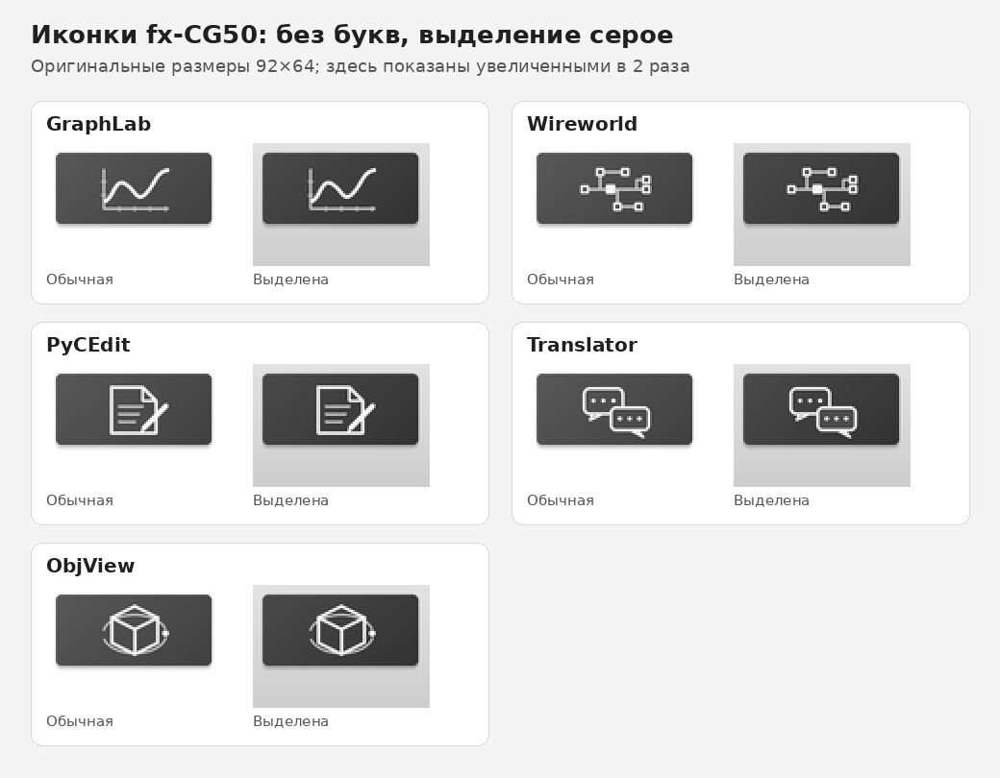

# Casio fx-CG50 Add-in Suite

A collection of native `.g3a` programs and developer resources for the
**CASIO fx-CG50**. Suite release **v1.02** collects the five applications
below. The suite number is separate from each application's version. The
calculator interfaces are in English; detailed project guides are mostly in
Russian.

> **Testing status:** these builds passed computer-side checks. GraphLab,
> Wireworld, PyCEdit and ObjView also have SuperH/QEMU tests with simulated
> events or VRAM. Complete testing of these exact files on physical hardware
> has not been confirmed: in particular, check PyCEdit's new colors and the
> appearance of selected menu icons on a real fx-CG50. QEMU and screenshots do
> not reproduce the calculator LCD, keyboard or Casio OS. Back up working
> add-ins and data before updating.

## Applications in v1.02

| Application | Version | Description |
|---|---:|---|
| [GraphLab](GraphLab/README.md) | 1.09 | 2D/3D graphs, implicit equations and fractals; longer formula entry and approximate 3D point preview. |
| [Wireworld](Wireworld/README.md) | 1.65 | A wrapping Wireworld field, patterns and editing tools; simulation colors are retained. |
| [PyCEdit](PyCEdit/README_RU.md) | 1.15 | Light Python/C editor with blue function names, red strings and a Python import-template list. |
| [Translator](Translator/README.md) | 1.11 | Offline Russian ↔ English translation; requires `TDIC.DAT`. |
| [ObjView](ObjView/README_RU.md) | 2.23 | Wavefront `.obj` viewer; ALPHA/F3 switch filename input modes. |

The five applications have new text-free grey menu icons, with a neutral grey
selected icon. Application names are drawn by the calculator menu. Whether
Casio OS adds its own blue selection effect needs a physical-device check.
The four programs other than PyCEdit have unchanged executable payloads;
only their icon fields and container checksums changed.

The [`releases/`](releases/) folder contains the current `.g3a` files.
[GitHub release v1.02](https://github.com/id-worker/CASIO-FX-CG50-developement-kit-VibeCode/releases/tag/v1.02)
provides one small installation ZIP and individual files. The previous v1.01
and v1.0 releases remain available. [`Wireworld_1.64/`](Wireworld_1.64/) and
`Wireworld/Wireworld_new.g3a` are historical, not the current release.

## Installation

1. Back up your existing `.g3a` files and important data, including GraphLab
   `GLAB*.DAT` / `GLQ8*.DAT`, `Wireworld.ww`, `.py`/`.c` files and 3D models.
2. Copy the desired `.g3a` files to the root of the calculator's USB storage.
   For Translator, also copy [`TDIC.DAT`](Translator/TDIC.DAT); its contents
   are unchanged from 1.10. Eject the calculator safely.
3. If an older light-editor `PyCLite.g3a` is installed, remove **that old
   add-in only** after making backups, then install the new `PyCEdit.g3a`.
   If an older `PyCEdit.g3a` exists, replace it after making a backup. Do not
   delete your `.py` or `.c` files. The new menu name is `PyCEdit`.
4. To try ObjView, copy `ObjView/models/torus.obj` to the root and enter
   `torus` without the extension. Filename input accepts Latin letters,
   digits, `.`, `-`, `_` and `/`; spaces, parentheses and Cyrillic are not
   available. In the model viewer ALPHA affects movement, not rotation speed.
5. GraphLab 1.09 imports older settings into its own `GLAB4_A/B.DAT` journal;
   old versions do not read GLAB4. See the project guide before switching.

## PyCEdit: highlighting and insertion lists

Open a `.py` or `.c` file and look for `[PY]` or `[C]` at the top. Function
names such as `print` and `printf` use blue; quoted strings use red. Two
medium-sized examples for inspecting highlighting are
[`COLORPY.py`](PyCEdit/Examples/COLORPY.py) and
[`COLORC.c`](PyCEdit/Examples/COLORC.c). They can be opened without running.
Actual LCD legibility remains to be checked on the calculator.

In the editor, **F3 SYM → F5 PYMOD** offers 18 `import` text templates, and
**F3 SYM → F4 LIBS** offers 62 C/PicoC/SDK headers. The Python menu does not
install modules or guarantee availability. `[FILE]` means a separate module
file is needed; `[SDK]` headers are not necessarily available in Utilities'
PicoC. See the PyCEdit guide for navigation and compatibility details.

## Кратко по-русски

**v1.02** — версия набора. В нём GraphLab 1.09, Wireworld 1.65, PyCEdit
1.15, Translator 1.11 и ObjView 2.23. Иконки пяти собственных приложений
обновлены; PythonExtra и Utilities не менялись. В PyCEdit оставлена светлая
тема, добавлен список Python-импортов, изменены цвета функций и строк и
исправлено имя в меню на **PyCEdit**. Перед установкой сохрани старые аддины
и файлы; если ставил `PyCLite.g3a`, удали именно старый аддин, не `.py`/`.c`.
Внешний вид новых цветов и иконок на приборе пока нужно проверить.

## Building and checks

- GraphLab and ObjView: install fxSDK/gint, enter the corresponding project
  folder and run `fxsdk build-cg`.
- Wireworld and PyCEdit: install a compatible libfxcg/PrizmSDK toolchain and
  `mkg3a`; set `FXCGSDK`, then run `make` in the project folder.
- Translator: see [`source/README_BUILD.txt`](Translator/source/README_BUILD.txt).
- `python3 release_tools/verify_icons.py` verifies the current G3As, icons,
  names, checksums and recorded payload baselines; it is not a hardware test.
  `release_tools/package_release.py` creates the small release ZIP.

[`win_gint/`](win_gint/) contains Windows Python resources and [`docs/`](docs/)
contains PicoC material. These do not replace the separate
[PythonExtra](https://github.com/id-worker/PythonExtra-4.0-beta-FX-CG50) and
[Utilities](https://github.com/id-worker/Utilities) repositories.

## Licenses and provenance

Original code is offered under the [MIT License](LICENSE), including the
`Alex Work` copyright credit. Third-party components and data retain their
own terms: see [THIRD_PARTY_NOTICES.md](THIRD_PARTY_NOTICES.md) and the
project-specific notices and licenses. The Translator dictionary's precise
attribution/license provenance and a menu-return code fragment in some
projects remain unresolved; warnings do not themselves grant rights.

PythonExtra and the GPL Utilities fork are maintained in separate repositories
and are not included in this release bundle. CASIO, PRIZM and fx-CG50 are
trademarks of CASIO COMPUTER CO., LTD.; this is unofficial third-party software.
