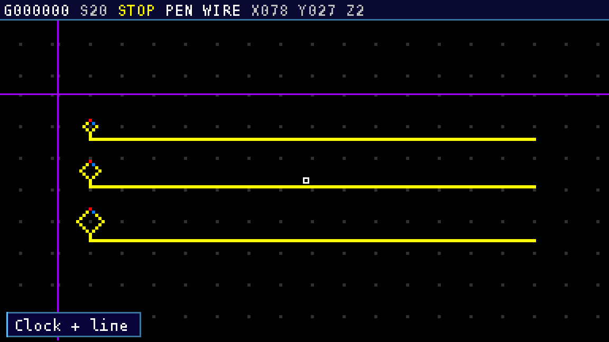
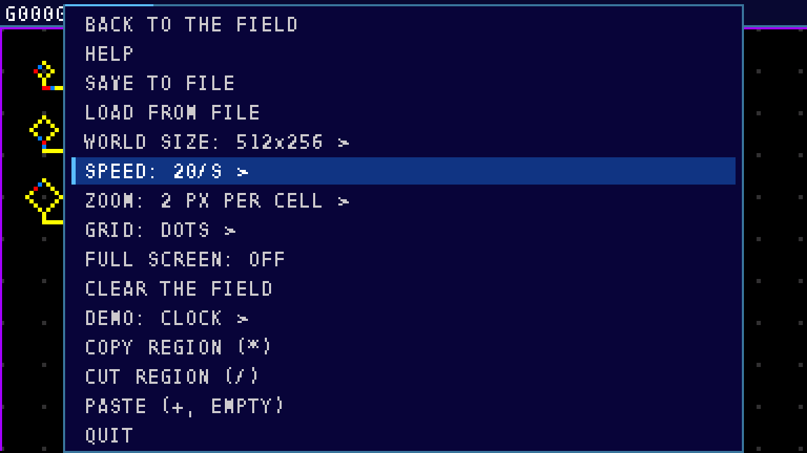

# Wireworld 1.64 для Casio fx-CG50

Нативный Wireworld с большим закольцованным полем, прокруткой и редактором.
Интерфейс — на английском. Готовый файл: **[Wireworld.g3a](Wireworld.g3a)**.

**Важно:** версия 1.63 проверена пользователем на калькуляторе; 1.64 прошла
автоматические тесты, но ещё требует проверки на самом fx-CG50. Проверенные
изображения в `preview/` — программные снимки VRAM, не фотографии устройства.
Также перед публичным распространением нужно разрешить вопрос с лицензией
старой функции выхода: см. раздел «Лицензии и происхождение» ниже.

## Установка и откат

1. Подключи калькулятор по USB. Если на нём есть важный `Wireworld.ww`, сначала
   скопируй этот файл на компьютер: команда сохранения перезаписывает его.
2. Скопируй новый **Wireworld.g3a** в корень накопителя калькулятора, заменив
   старый файл. После безопасного извлечения открой Wireworld из главного меню.
3. Для отката возьми `backup/Wireworld_1.63.g3a`, переименуй его в
   `Wireworld.g3a` и снова замени файл в корне калькулятора. Это точная копия
   проверенной версии, без исправления её заголовка и без пересборки.

Сохранение и загрузка используют `Wireworld.ww` в Storage Memory. Формат
совместим с 1.63. Если при загрузке крупного файла не хватает памяти,
приложение может загрузить только часть поля — внимательно смотри сообщение.

### Короткая проверка на калькуляторе

* При старте должна быть видна схема CLOCK. F1 — запуск/пауза, F2 — один шаг,
  F4 — следующая схема, F5 — изменение скорости.
* Проверь отсутствие полос, движение курсора, масштаб 7/9 и меню OPTN. Выбор
  материала 0–3 не должен рисовать клетку; EXE ставит клетку.
* Проверь копирование: `*`, EXE в двух углах, `+`, `-` для поворота, EXE для
  вставки. EXIT возвращает к перу.
* При необходимости проверь SAVE/LOAD на тестовом поле, предварительно сохранив
  свою прежнюю схему на ПК. Затем MENU и сразу повторный запуск Wireworld.

## Управление

| Клавиша | Действие |
|---|---|
| Стрелки | Двигать курсор; камера следует за ним |
| SHIFT + стрелка | Прыжок на 10 клеток |
| 0 / 1 / 2 / 3 | Выбрать стирание / проводник / голову / хвост; поле не меняется |
| EXE | Поставить выбранный материал или отметить начало/конец фигуры |
| 0–3 + стрелка | Рисовать выбранным материалом при движении |
| 4 / 5 / 6 | Перо / линия / прямоугольник; повторная 6 меняет заливку |
| `*` / `/` | Копировать / вырезать прямоугольник: EXE, переместить курсор, EXE |
| `+` | Вставка; повторно — прозрачная / с перезаписью пустых клеток |
| `-` или `)` | Поворот вставки на 90° по часовой стрелке |
| SHIFT + `-` или `(` | Поворот на 90° против часовой стрелки |
| `.` / `(-)` | Отразить вставку горизонтально / вертикально |
| SHIFT + 8 / SHIFT + 9 | Копировать / вставить |
| 7 / 9 | Уменьшить / увеличить масштаб |
| 8 | Скрыть / показать строку состояния |
| F1 / F2 / F3 | Пуск-пауза / шаг / очистить поле |
| F4 / F5 / F6 | Следующая демо-схема / скорость / справка |
| OPTN | Настройки, файл, схемы, копирование и вставка |
| EXIT | Отменить фигуру, выйти из инструмента или подтвердить выход |
| MENU | Вернуться в главное меню |

F4 заменяет текущее поле демонстрационной схемой. Для важных схем перед
очисткой, сменой размера или демо используй SAVE и сделай копию файла на ПК.
Смена размера может очистить поле, если не хватает памяти для двух миров сразу.

Поле выбирается из размеров от 128×128 до 512×256 клеток; доступный максимум
зависит от свободной памяти калькулятора. Края замкнуты: переход через край
ведёт на противоположную сторону. Масштабы: 1, 2, 3, 4, 6 и 8 пикселей на
клетку. Скорости: 1, 2, 5, 10, 20, 30, 60 поколений/с и MAX; фактическая
скорость зависит от размера и содержимого поля.

Правила: пустая клетка остаётся пустой; голова становится хвостом, хвост —
проводником; проводник становится головой, если среди 8 соседей ровно 1 или
2 головы. Жёлтый — проводник, голубой — голова, красный — хвост, белый —
курсор, сиреневый — шов закольцованного поля.

## Что изменено в 1.64

* Обновлены панели, цветовая схема и компактный встроенный шрифт 6×11; подписи
  остаются английскими. Строка состояния занимает 13 пикселей по высоте.
* При загрузке демонстрационной схемы камера наводится на неё, не перемещая
  сами клетки. Меню и справка полностью помещаются в программных тестах.
* Оптимизирован шаг автомата для выровненных стандартных полей, особенно при
  небольших активных участках. Для плотного поля и нестандартных ситуаций
  остаётся обычный алгоритм. Измерения на компьютере не являются измерениями
  скорости калькулятора.
* Экран не обновляется постоянно во время простоя; во время работы кадры могут
  объединяться. Планировщик скорости не блокирует управление и учитывает
  полуночный сброс часов. Работа на реальном устройстве ещё не подтверждена.

Пример замера **только ядра на ПК**, поле 512×256, GCC `-Os`, Intel Xeon
2.60 GHz, лучший результат из трёх повторов (`tools/bench_step.c`):

| Сценарий | 1.63, мкс/шаг | 1.64, мкс/шаг |
|---|---:|---:|
| CLOCK в центре | 358,26 | 16,57 |
| CLOCK по противоположным краям | 379,75 | 53,79 |
| Плотный случайный мир, восстановление перед каждым шагом | 1764,73 | 1602,21 |

Контрольные суммы клеток и суммы уведомлений в этих опытах совпали.
Это не FPS приложения и не замер на fx-CG50: выигрыш на калькуляторе зависит
от схемы, отрисовки и фактической скорости процессора.

## Проверки перед передачей

* Оригинальное ядро 1.63 и новое: 1 084 сценария / 7 588 поколений на хосте;
  совпали клетки, маска голов, порядок уведомлений, счётчики и края мира.
  Проверены также 1 024 отдельных положений и изменяющий поле callback.
* Тесты правил и схем; 157 проверок интерфейса, 181 проверка шрифта и
  геометрии, 148 проверок планировщика. Повторено с ASan/UBSan и отдельно
  на big-endian MIPS под QEMU.
* На big-endian SH4A под QEMU: 252 сценария / 1 512 поколений ядра совпали
  с 1.63. Это тест процессорных инструкций, а не эмуляция калькулятора.
* Файл G3A проверен независимой утилитой `fxgxa`: 12/12 полей и контрольных
  сумм; исполняемое содержимое совпадает с собранным `.bin`, иконки сохранены.




## Исходники и сборка

Для сборки нужны PrizmSDK/libfxcg, `sh3eb-elf-gcc`, `mkg3a`, GNU make и
Python 3. Встроенный шрифт уже находится в `src/font_ww.h`, поэтому Pillow и
TTF при обычной сборке не требуются.

```sh
export FXCGSDK=/путь/к/libfxcg
export PATH=/путь/к/инструментам/bin:$PATH
make
```

`make` создаёт `Wireworld.g3a`, затем `tools/fix_g3a.py` заполняет обе
контрольные суммы. Не копируй на калькулятор `.bin` — нужен именно `.g3a`.

Тесты на Linux с GCC: `sh tools/run_tests.sh`. Для ASan/UBSan:

```sh
CFLAGS='-O1 -g -fno-omit-frame-pointer -fsanitize=address,undefined -fno-pie -no-pie' sh tools/run_tests.sh
```

При установленных кросс-компиляторах и QEMU дополнительные проверки можно
повторить командами `sh tools/run_mips_tests.sh` и `sh tools/run_sh_qemu_test.sh`;
для последней нужны также `FXCGSDK` и `sh3eb-elf-gcc` в PATH.

Опциональный `tools/build_toolchain.sh` собирает инструменты под Debian/Ubuntu.
Нужны установленные build-essential, texinfo, bison, flex, libgmp-dev,
libmpfr-dev, libmpc-dev, libpng-dev, cmake, curl, xz-utils и sha256sum.
Компиляция может занять много времени; скрипт скачивает исходники. Архивы GNU
привязаны к SHA-256, а libfxcg и mkg3a скачиваются из веток master, поэтому
они могут измениться со временем. Восстановление SDK этим скриптом на другой
машине не проверялось; для использования приложения сборка не нужна.

* `src/` — программа, движок, схемы и встроенный шрифт.
* `tools/` — тесты, генераторы и проверочная копия движка 1.63.
* `preview/` — снимки программной VRAM, увеличенные без сглаживания.
* `licenses/` — тексты лицензий сторонних компонентов.
* `backup/` — аппаратно проверенный оригинал 1.63.

## Лицензии и происхождение

Собственный код — MIT, `LICENSE` содержит строку `Alex Work` под
`Copyright (c) 2026 Contributors`. Шрифт и SDK имеют отдельные уведомления в
`THIRD_PARTY_NOTICES.md` и `licenses/`.

**Оговорка для публикации:** унаследованная функция `set_menu_return_flag` в
`src/main.c` соответствует функции Simon Lothar, которая встречается в исходниках
GPL-проекта Utilities. На странице с исходным примером явное разрешение на
MIT-лицензирование этого фрагмента не найдено. Поэтому пока нельзя считать, что
весь исходный код или бинарник целиком очищены для публикации как MIT: нужно
выяснить условия использования или заменить фрагмент и заново проверить выход
на калькуляторе. Рабочий путь выхода в этой сборке намеренно сохранён.
Подробности и ссылки — в `THIRD_PARTY_NOTICES.md`.

Casio и fx-CG50 — товарные знаки CASIO COMPUTER CO., LTD. Проект независимый;
ROM калькулятора в архив не включён.
